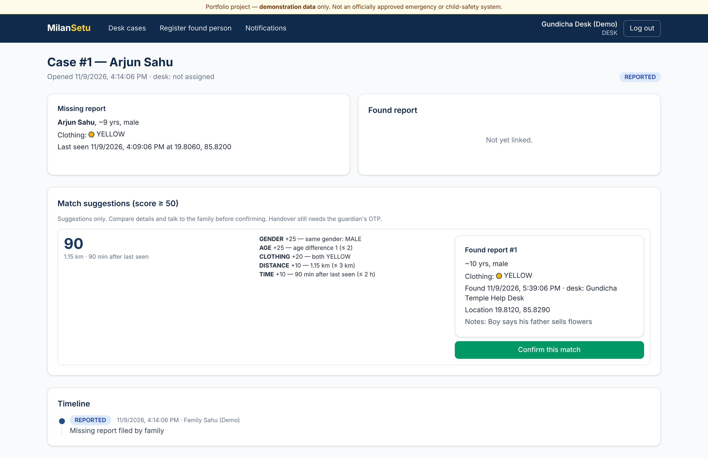
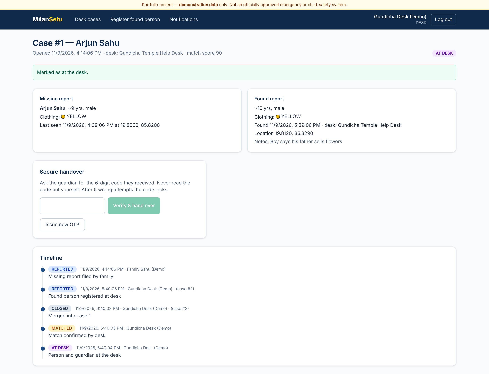
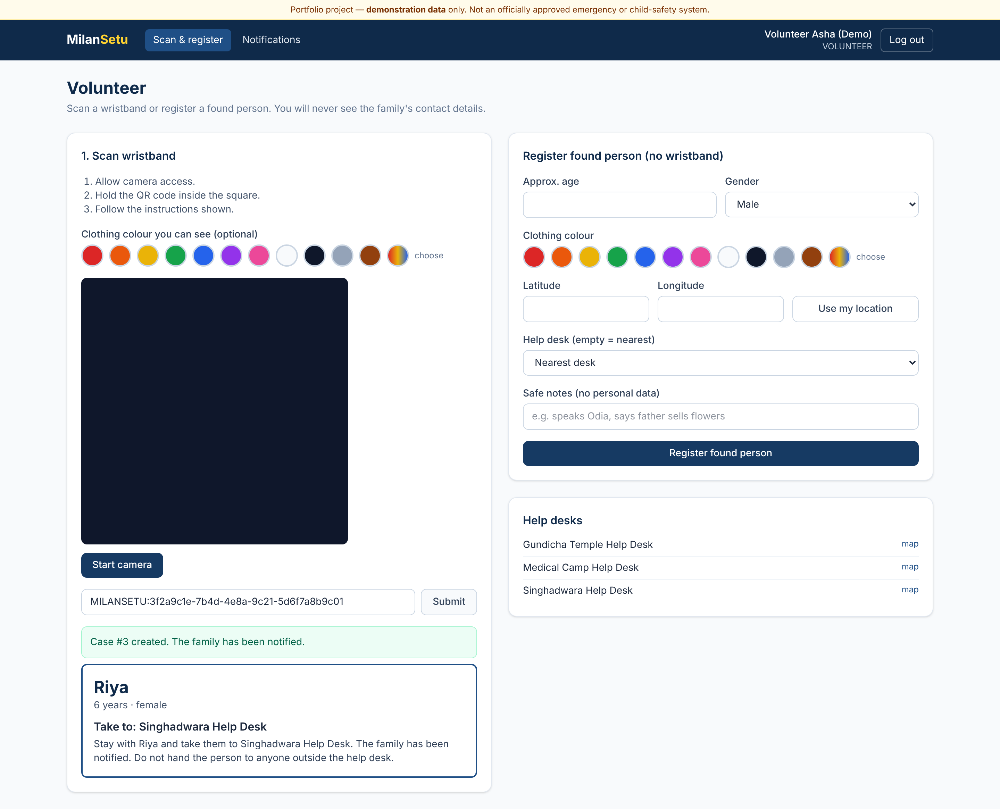
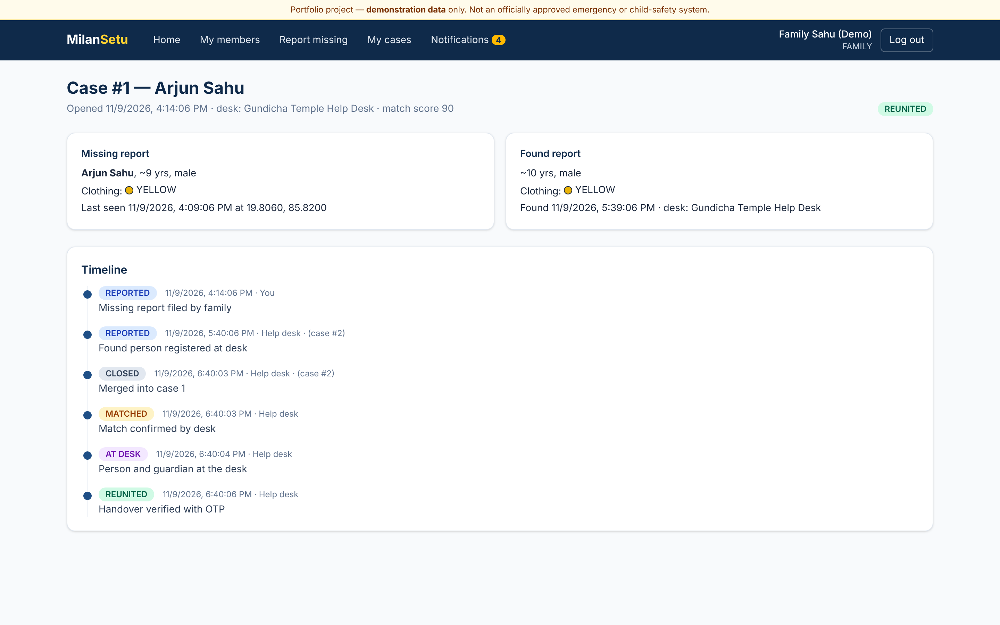
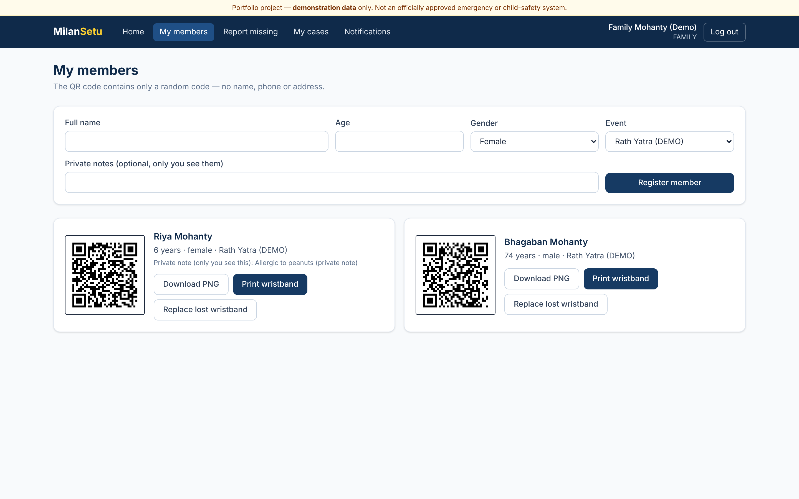
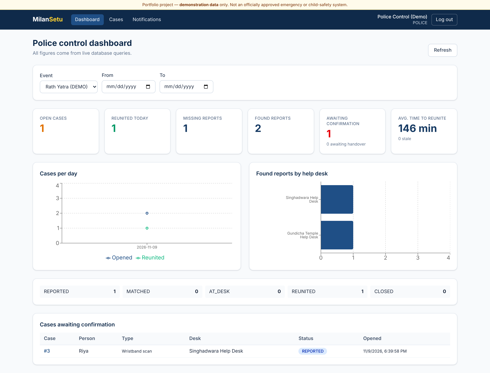
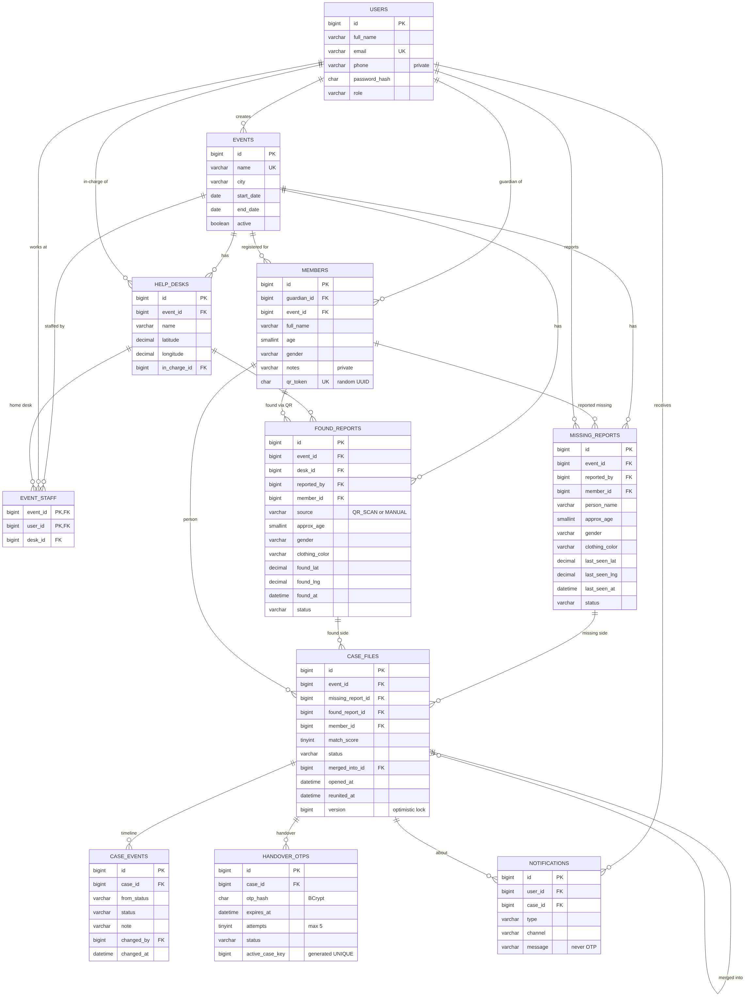

# MilanSetu — Festival Lost & Found Reunification Platform

> **Portfolio project with demonstration data. It is not an officially approved emergency-response or child-safety system.** Real-world use would need organisational, legal and privacy validation.

MilanSetu helps reunite missing children and elderly people with their families at crowded festivals (Rath Yatra, Bali Jatra, melas). It replaces paper registers and loudspeaker announcements with:
- QR wristbands
- a weighted missing/found matching engine
- desk-confirmed matches
- an **OTP-verified handover**
- a complete case timeline

Guardian phone numbers are never shown to volunteers or desk staff.

## Status

| Part | State |
|---|---|
| Backend build (`mvn verify`) | ✅ BUILD SUCCESS |
| Tests | ✅ **68 / 68 passed** (48 unit/Mockito + 20 integration on real MySQL 8), concurrency test 5/5 |
| Coverage | **85.3 %** overall, **88.7 %** service layer (JaCoCo) |
| Frontend | ✅ lint + production build |
| Docker Compose | ✅ stack ran healthy; screenshots taken from it |
| Live deployment | ⬜ not deployed (no URL claimed) |

## Screenshots

| | |
|---|---|
|  Match suggestions with reasons |  OTP handover |
|  Volunteer scan (no guardian data) |  Family timeline |
|  QR wristbands |  Police dashboard |

More in [docs/screenshots](docs/screenshots).

## Workflow

1. The admin creates the event and its help desks.
2. A family registers a member. The app generates a random QR token and a printable wristband.
3. When a volunteer scans the wristband, a found case opens and the guardian is notified. The volunteer sees only the first name, age and target desk.
4. Families can also report someone missing. Desks can register people found without a wristband.
5. The **matching engine** ranks suggestions (score ≥ 50) with an explanation of each score.
6. **Desk staff confirm** the match. The guardian receives a one-time OTP.
7. With the person and guardian at the desk, staff enter the OTP. Only then does the case become **REUNITED**.
8. Every step is recorded in the case timeline.

## Technology

| Area | Stack |
|---|---|
| Backend | Java 21, Spring Boot 3.5.16, Spring MVC, Data JPA, Hibernate, Spring Security, JWT (jjwt 0.12), Bean Validation, Spring Mail, Spring Scheduling, ZXing 3.5.3 (QR), springdoc OpenAPI |
| Database | MySQL 8 + Flyway |
| Frontend | React 19, TypeScript, Vite 6, React Router 7, Tailwind 4, Axios, Recharts, html5-qrcode |
| Testing | JUnit 5, Mockito, Spring Boot Test, MockMvc, Testcontainers, JaCoCo, Postman |
| DevOps | Maven, Docker, Docker Compose (MySQL, Mailpit), Nginx, GitHub Actions |

## Architecture

```
React SPA ─► Nginx (SPA, /api proxy, CSP, camera permission) ─► Spring Boot ─► MySQL 8
                                     controller → service → repository
                                     JWT filter · AccessPolicy (ownership + event scope) · rate limits
                                     NotificationSender (mock | email) · schedulers (OTP expiry, stale cases)
```



Details:
- [architecture](docs/architecture.md)
- [database design](docs/database-design.md)
- [ER diagram](docs/ER-diagram.md)
- [API](docs/api-documentation.md)

## Matching algorithm

| Factor | Points |
|---|---|
| Same gender | 25 (hard filter) |
| Age difference ≤ 2 / ≤ 5 | 25 / 12 |
| Same clothing colour | 20 |
| Distance ≤ 1 / ≤ 3 km (Haversine) | 20 / 10 |
| Found within 2 h / 6 h | 10 / 5 |

Suggestions need a score of at least 50 and are sorted by score; staff always confirm manually. Full details: [docs/matching-algorithm.md](docs/matching-algorithm.md).

## Security

- BCrypt passwords; JWT with logout revocation
- FAMILY-only public sign-up
- Event-scoped staff; owner-only member data
- Random UUID QR tokens; generic scan errors
- Hashed OTPs: 10-minute expiry, 5 attempts then lock, single use
- `@Version` against double handover
- Rate limits; no phone numbers in staff DTOs; audit logs

See [docs/security-and-privacy.md](docs/security-and-privacy.md).

## Run locally

```bash
cp .env.example .env              # set passwords + JWT_SECRET (openssl rand -base64 48)
docker compose up --build
```

- App: http://localhost:8082
- Swagger: http://localhost:8082/swagger-ui.html
- Mailpit: http://localhost:8025

**Demo credentials (dev only):** password `Demo@1234`. Accounts:
- `family1@milansetu.demo`
- `volunteer@milansetu.demo`
- `desk1@milansetu.demo`
- `police@milansetu.demo`
- `admin@milansetu.demo`

Full list and demo wristband codes: [docs/user-guide.md](docs/user-guide.md).

## Tests

```bash
cd backend && mvn verify
cd frontend && npm ci && npm run lint && npm run build
```

Postman collection: `postman/MilanSetu.postman_collection.json` (29 requests, the full workflow). Honest results: [docs/testing.md](docs/testing.md).

## Learn and prepare

- [docs/code-walkthrough.md](docs/code-walkthrough.md)
- [docs/interview-preparation.md](docs/interview-preparation.md)

## Known limitations

- Not deployed yet. A free single-VM deployment is described in docs/deployment.md.
- The rate limiter is in-memory (single instance).
- No SMS (paid gateway); e-mail and in-app notifications only.
- Camera scanning needs HTTPS (or localhost).
- Demonstration data only.

## Future scope

- found items (bags, phones) with the same matching approach
- SMS
- missing-person hotspot map
- Odia and Hindi UI
- event archives

## License

MIT, © 2026 Rajesh Behera
