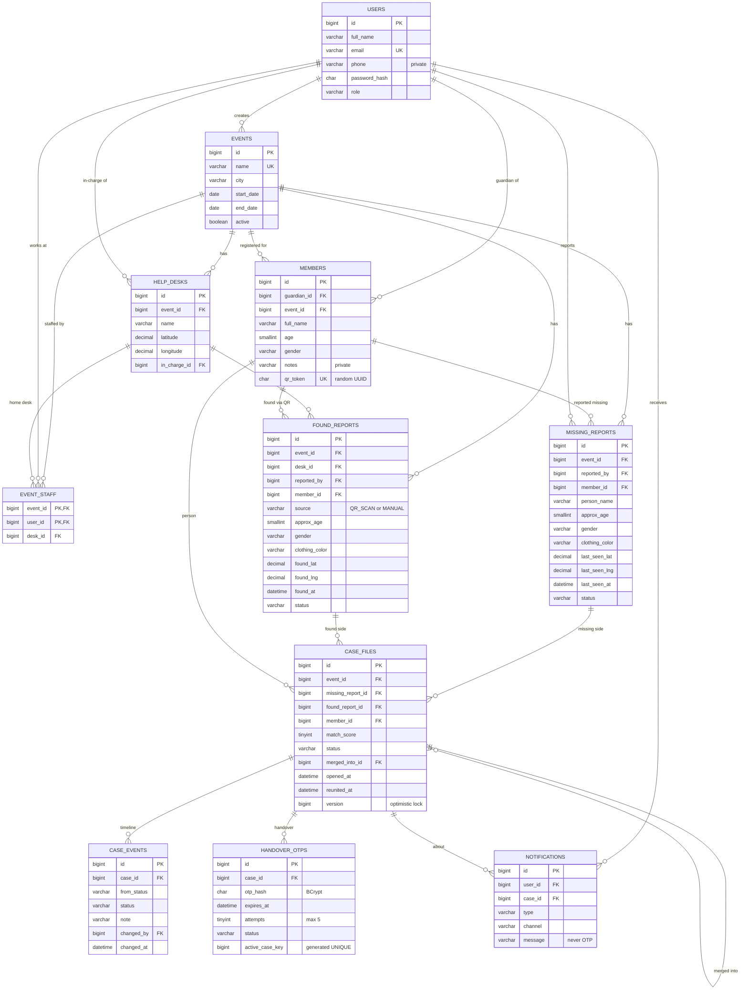

# MilanSetu — ER Diagram

Source of truth: `backend/src/main/resources/db/migration/V1__init_schema.sql`. Audit timestamps are left out of the diagram.

Supporting tables not drawn: `revoked_tokens` and `audit_logs`.
